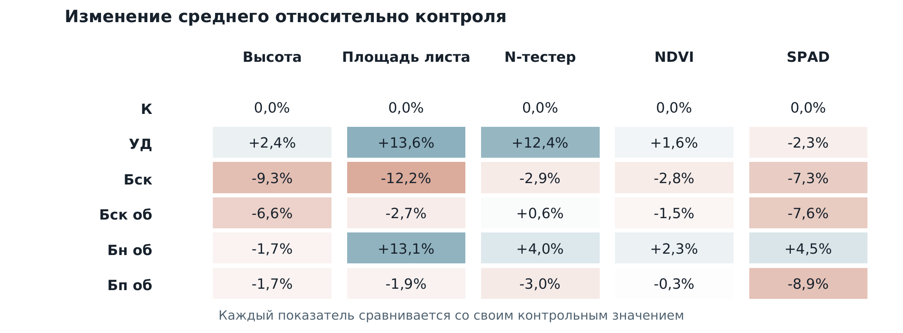
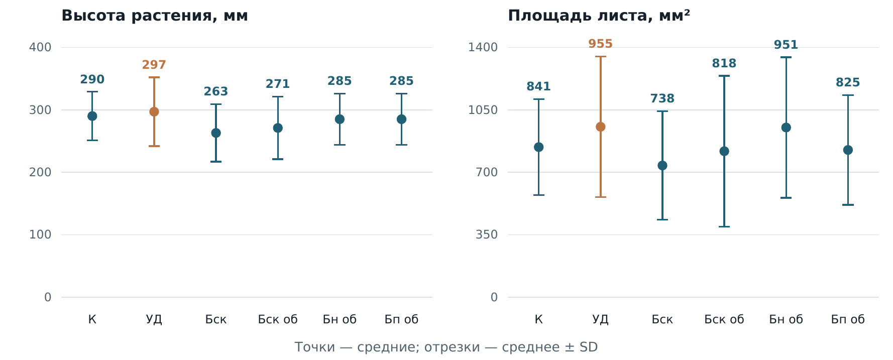
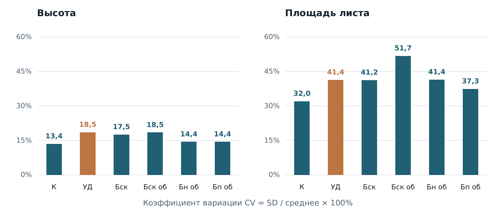

# Анализ эксперимента и сравнение групп

<br clear="all">

## Сравнение биоугольных составов с контролем

В групповом исследовании я сравнивал шесть вариантов обработки пшеницы. Для следующего опыта мы выбрали обогащённый биоуголь из навоза. Его средняя площадь листа — **951 мм²**, у контроля — **841 мм²**, разница **+13,1%**. При выборе мы учитывали несколько показателей, а не только площадь листа.



### Применённые навыки

| Навык аналитика | Как я его применил |
|---|---|
| Сравнение групп с базой | Использовал почву без добавок как контроль |
| Нормировка показателей | Рассчитал относительные изменения в процентах |
| Работа с вариативностью | Сопоставил стандартные отклонения и коэффициенты вариации |
| Сравнение нескольких метрик | Учёл высоту, площадь листа и физиологические измерения |
| Сегментация экспериментальных данных | Сопоставил тип сырья, обогащение и условия внесения; показатели разных шкал оценивал отдельно |
| Интерпретация эксперимента | Разделил описательное преимущество и доказательство значимости |
| Python и таблицы | Подготовил сводную таблицу CSV и расчёт сравнительных показателей |

### Данные и мой вклад

Шесть вариантов, по три повторности. По всей схеме выполнены 180 измерений N-тестером и 90 спектральных измерений CI-710s; дополнительно измерены высота и размеры листьев. Я сравнивал средние и разброс, сопоставлял варианты с контролем и обсуждал выбор с командой. Эти общие численности не считаю количеством независимых повторностей.

Ростовые показатели сопоставлял с показаниями N-тестера и спектральными индексами NDVI, SPAD, CPHLT и PRI. Для сравнения использовал контроль и вариант с минеральными удобрениями, учитывая различия шкал и условий обработки.

| Вариант | Высота, мм, среднее ± SD | Площадь листа, мм², среднее ± SD |
|---|---:|---:|
| Контроль | 290 ± 39 | 841 ± 269 |
| Минеральные удобрения | 297 ± 55 | 955 ± 395 |
| Биоуголь из скорлупы | 263 ± 46 | 738 ± 304 |
| Обогащённый из скорлупы | 271 ± 50 | 818 ± 423 |
| Обогащённый из навоза | 285 ± 41 | 951 ± 394 |
| Обогащённый из помёта | 285 ± 41 | 825 ± 308 |



Отрезки — среднее ± SD, а не доверительные интервалы. Площадь листа рассчитана по длине, ширине и коэффициенту формы 0,65.

### Что показало сравнение

У выбранного состава площадь листа выше контроля на 13,08%, высота ниже на 1,72%. NDVI — 0,813 против 0,795; SPAD — 30,58 против 29,27; N-тестер — 438,5 против 421,7. Единого лидера по всем показателям нет.



CV площади листа выбранного состава — 41,43%, контроля — 31,99%. По этим данным я не утверждаю, что выбранный состав стабильнее контроля.

### Пример кода

```python
relative_change = 100 * (group_mean / control_mean - 1)
coefficient_of_variation = 100 * group_sd / group_mean
```

В [compare_groups.py](compare_groups.py) рассчитываю относительные изменения и коэффициенты вариации по [bio-summary.csv](bio-summary.csv). Запуск: `python compare_groups.py`.

### Для каких аналитических задач это полезно

Сравнение тестовых вариантов с базовым, выбор метрик эксперимента и объяснение компромисса между средним результатом и разбросом. Такой подход помогает подготовить следующий опыт и заранее определить критерий выбора.

### Ограничения

Анализ основан на сводных средних и стандартных отклонениях; индивидуальные наблюдения в репозитории не представлены. Поэтому здесь нет проверки статистической значимости или причинного эффекта. Для неё нужны исходные измерения с учётом структуры повторностей. Площадь листа не заменяет измерение урожайности или экономического результата.

---

[← Все проекты](https://github.com/antonyakovlev11)
